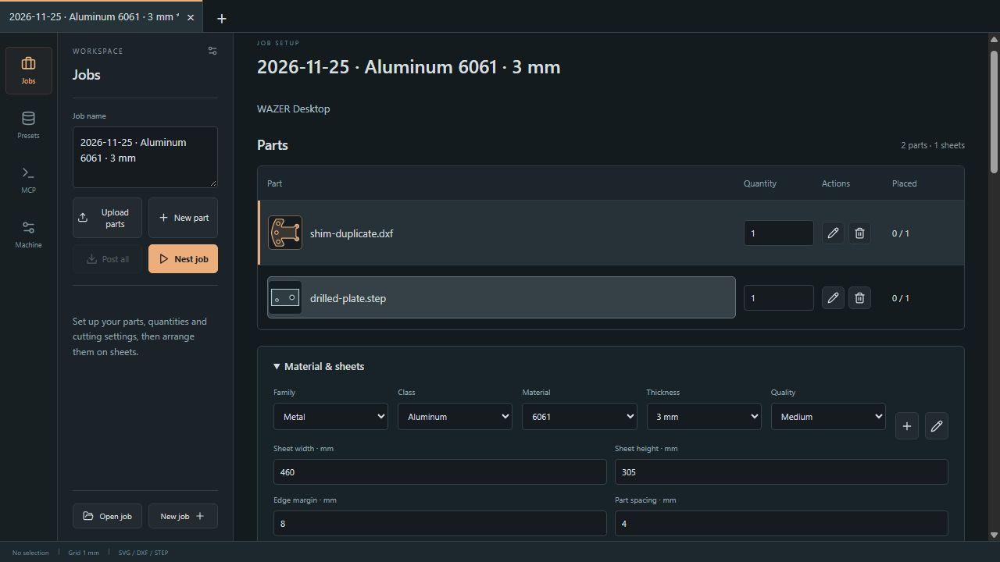

# Wam Local

A desktop waterjet CAM application for WAZER Desktop and WAZER Pro. Import parts, edit cutting geometry, nest a job across sheets, simulate the toolpaths and post cut files.

[](https://github.com/AudacityMicro/WamLocal/releases/latest/download/Wam-Local-Setup.exe)

## Install on Windows

1. Click **Download Windows Installer** above and run `Wam-Local-Setup.exe`.
2. The installer automatically selects the correct version, installs it for your Windows account, creates Start menu and desktop shortcuts, and opens Wam Local.

That is the complete setup. **Do not install Node.js, npm, Python, Electron, a browser extension or any other prerequisite.** The installer includes the application runtime, material presets, STEP reader and nesting engine. It also works without an internet connection after the installer has been downloaded. Administrator access is normally unnecessary for this per-user installation; managed computers may have organization-specific restrictions.

**Supported systems:** Windows 10 and Windows 11 on Intel/AMD x64, ARM64 and 32-bit x86. One installer contains all three builds and chooses automatically. Windows 7/8/8.1, macOS and Linux are not supported by this release. ARM64 and x86 packages are supplied, but runtime validation for this release was performed on x64 Windows.

**Windows security prompts:** This release is unsigned. Windows may ask you to approve an unrecognized application, and managed computers can block it. Signing requires a trusted code-signing certificate; prerequisite-free installation does not bypass Windows security policy.

If you have been running a development, portable or unpacked copy, save your jobs and close that copy before installing. Use the installer-created shortcut afterward. Your shared material presets stay in your Windows profile; jobs stay wherever you saved their `.wam` files.

## First job

1. Choose your machine in **Machine**. The machine preference is retained for new jobs.
2. In **Jobs**, use **Upload parts** or **New part**. Select the job's material, thickness and quality; set the sheet dimensions and quantities.
3. Open a part with its pencil icon to edit geometry, kerf side, stock to leave, tabs and leads.
4. Click **Nest job**, then inspect each sheet preview. The WCS picker can reference the sheet or the combined bounds of its placed parts.
5. Use **Simulate**, **Post sheet** or **Post all**. The posting report includes estimated time, abrasive usage and cost. Copy the generated `.gcode` files to the machine's SD card.
6. Save the job with **File → Save** or **Ctrl+S**. A `.wam` file contains the parts and job settings; original import files are not needed to reopen it.

New and Open create separate job tabs. **Ctrl+Tab / Ctrl+Shift+Tab** switch tabs; **Ctrl+W** closes the current job with an unsaved-change prompt. Quantity **0** retains a part while excluding it from nesting and posting.

## Features

- SVG, DXF, STEP/STP and raster imports. SVG/DXF curves use configurable flattening tolerance; text and images can be converted into cut outlines.
- STEP planar-face extraction with automatic face ranking, holes and an alternative-face selector. Each import selects one face, including when a model contains multiple bodies.
- Basic vector drawing and node editing; part copy/paste, rotation and duplication; part thumbnails.
- SVGnest-based nesting with rotation, spacing, margins, locks, grain constraints, optional nesting inside holes and adaptive search budgets.
- Shared material/preset and machine databases, editable from the app. **Save presets** provides explicit saving; automatic saving remains enabled.
- Per-contour kerf compensation, stock to leave, draggable tabs and lead-ins, lead overlap, and tangent-lead clearance around retaining bridges.
- Inches/mm display toggle. Numeric fields accept calculations and compatible units: `1/8 in`, `(2+3)/2`, `2in * 3in`, or `1 in/s`. Enter or leaving the field calculates; Escape cancels.
- G-code simulation with zoom, playback, stepping and seeking.
- A bundled MCP server with 48 tools for saved jobs, imports, geometry, materials, nesting, simulation and posting.



## Updating and uninstalling

Choose **Help → Update from GitHub…** to check for a newer stable release. Updates are optional and checks occur only when requested. Save open jobs before installing an update. Download verification uses the published update metadata and checksums.

You can also run the latest installer again. Remove Wam Local through **Windows Settings → Apps → Installed apps**. The uninstaller preserves application data and does not delete saved job files.

## Files and presets

Jobs are self-contained `.wam` files with embedded geometry, quantities, sheet placements and process settings. Shared presets and preferences are automatically stored in `material-library.json` inside Electron's per-user application-data directory. Use **Presets → Export database** for a portable backup. Changing a shared preset does not silently replace an existing job's embedded material snapshot.

## MCP server

Install the app normally, then open its **MCP** page. Copy the generated client configuration: it includes the installed executable and server paths, a writable jobs directory and the shared presets path. No separate Node.js installation is required. The page includes setup instructions, the tool list and an end-to-end sample prompt.

The server works on saved jobs in the configured directory. Reopen externally changed jobs in the editor to see MCP changes. It does not operate the physical machine or manipulate unsaved editor tabs.

## Current limits

- STEP import extracts closed planar faces; it does not flatten curved surfaces. Review blind pockets and obstructed openings before treating them as through-cuts.
- Nesting is a bounded search and does not prove an optimum or that an unfitted layout is impossible.
- Material interpolation and substituted process profiles are starting values, not measurements for every machine/material/thickness combination.
- Water-only cutting, engraving, machine connectivity and remnant inventory are not included.
- This independent application is not made or approved by WAZER. Firmware behavior and physical cut quality still require machine-specific validation. Inspect the posted paths and process settings before cutting.

## Build from source

Development requires Node.js 24 and npm; end users do not need either.

```powershell
npm ci
npm run dev
```

```powershell
npm test -- --maxWorkers=2
npm run build
npm run verify:mcp
npm run package
```

`npm run package` builds one self-contained installer containing x64, ARM64 and x86 packages. Publishing is disabled for local builds. A pushed `v<package version>` tag runs the release workflow, tests and verifies the packages, and publishes the installer with its update metadata.

Additional integration checks:

```powershell
npx tsx scripts/verify-mcp-guide.ts
npx tsx scripts/verify-mcp-workbench.ts
npx tsx scripts/verify-step.ts
```

Set `WAM_MCP_EXE` to the packaged x64 `Wam Local.exe` to run these checks against the packaged application. Installer hashes are in the release's `SHA256SUMS.txt`; update verification also uses `latest.yml` and the blockmap.

## License

Wam Local's original code and documentation are licensed under the [BSD Zero Clause License (0BSD)](LICENSE). You may use, copy, modify, redistribute and sell them for any purpose, including in closed-source products, without attribution or a requirement to publish your changes. The software is provided without warranty.

Third-party components and externally sourced fixtures retain their respective licenses and rights; the project license does not relicense them. See [THIRD_PARTY.md](THIRD_PARTY.md) and [licenses](licenses/), including [the STEP reader notice](licenses/STEP-reader-notice.md).

Earlier development notes are archived in [Development history](docs/DEVELOPMENT-HISTORY.md); future work is listed in [ROADMAP.md](ROADMAP.md).
