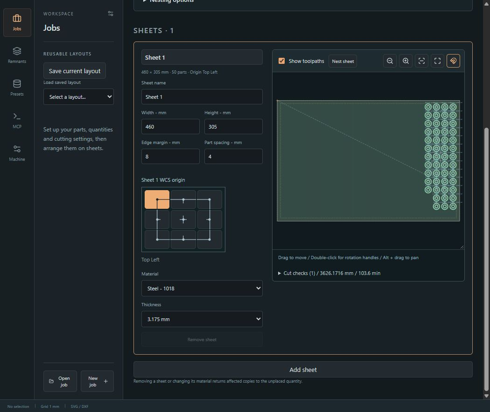

# Wam Local

An independent, offline waterjet design and CAM workbench for power users. Electron + React + TypeScript, with a shared geometry engine and a local MCP server. This is a working **0.7 alpha**, with independent WAZER posting pending physical-machine validation.



## Version 0.7 posting

Each sheet preview has **Post sheet** and **Post all**, and Jobs has a **Post all** button. The File menu offers the same actions when context permits. Post sheet chooses one .gcode file; Post all chooses a folder and writes a separate file for every populated sheet. Empty sheets are skipped. Post all checks that every requested copy is placed; single-sheet posting can export a partial job. Existing files require replacement confirmation, and a failed batch restores replaced files. Exporting does not operate the machine.

The independent postprocessor emits metric absolute WAZER motion (G90/G21), startup/shutdown metadata, high-pressure and abrasive on/off commands, per-part feed and pierce dwell, and three shutdown dwell seconds per cutting operation. Contours are compensated using the job's machine kerf and stock allowance. Tabs split contours into independent cutting spans: the jet is off for travel between spans, with a new scrap-side lead-in and pierce on each span, and a scrap-side lead-out before stopping. Preview toolpaths and posted operations share that plan. Configured feeds are constant; this does not reproduce WAM's adaptive feed scheduling or curved lead geometry.

Coordinates map sheet placement back to the machine bed, with negative controller Y. The nine-point sheet origin remains a work-coordinate reference and is described in the header; it does not enable unsupported controller work offsets. Cut Extents include the jet footprint. Resume-after-pause uses the sheet's largest pierce time; differing per-part dwell values are reported. Time estimates include pierces and shutdown waits, but exclude rapid travel.

Preflight blocks unverified material profiles, wrong-machine settings, missing geometry, invalid feed, overlaps, bounds, stock-outline/exclusion violations and leads crossing another part. Pierce/stop footprint interference and shortened leads are reported for review. Windows output uses short .gcode filenames and atomic staged batch writes. The browser development build downloads Post all as a ZIP. MCP has matching `post_sheet` and `post_all` tools, with replacement disabled unless explicitly requested.

Protocol evidence: [manufacturer command documentation](https://support.wazer.com/resources/maintenance/wam-procedures/understanding-g-code-on-wazer), the captured WAM 2.5.0 Pro files, and public manufacturer Desktop/Pro welcome-cut files. Source URLs, hashes and control facts are in `fixtures/posting/protocol-sources.json`. The post uses the observed 2.5.0 Pro and 1.4 Desktop dialect metadata, while identifying Wam Local as the generator. Command replay, geometry, file output and UI downloads are tested. **Physical machine cutting and firmware-specific acceptance have not been verified.**

## Version 0.6.2 gauge captures and saved profile selection

The recorded catalog now contains 560 Pro material/thickness records across all 24 materials, including every 7-26 gauge for Aluminum 6061, Stainless 304/316, and Steel 1018/1095/A2. All three quality feeds are captured for each. Of these records, 526 have usable captured tab/lead defaults (1,578 complete quality profiles); 34 retain flagged tab-default outliers. Desktop requires its own captures.

When a saved job contains an older unverified profile, its Quality list now also offers the complete **WAM reference** of the same quality. Choosing that entry, or reselecting the material/thickness, applies the recorded settings. Existing embedded values remain until that explicit choice. Quality menus in jobs and part editors filter to the active machine; the presets database can still show both machines.

## Version 0.6.1 profiles and hole leads

All recorded thicknesses now appear in the global presets database with Coarse, Medium and Fine choices. The first expansion has 450 Pro thickness captures, including a new 0.020-inch Aluminum 6061 capture on 2026-11-16 (605 / 537.78 / 470.55 mm/min and 1.21 seconds pierce). Exact quality feeds are preserved. Records with invalid tab/lead defaults retain the captured process rates but use an explicitly flagged application tab/lead default. Uncaptured gauge and Desktop profiles are marked **Needs settings**, with no interpolation or reuse of another machine's feed. Library upgrades preserve edited defaults and embedded jobs.

Closed-profile leads now approach from scrap: inside holes and outside external profiles, independent of winding or placement rotation. Manual entry points are retained. Leads are shortened and reported if they would cross another edge of the same contour. Pierce footprint checks still flag insufficient space. This does not yet provide collision avoidance against other parts or fixtures.

## Version 0.6 Jobs workspace

Jobs contains the part list, expanded nesting options, and sheet cards with interactive previews alongside stock size, material and nine-point sheet origin controls. Nesting, Sheets and Toolpaths no longer have separate navigation entries. Each preview has a toolpath toggle, mouse placement/rotation, duplicate/delete, placement locks, and source-part editing. Reusable layouts remain in the Jobs sidebar. Remove empty sheets cleans up unused sheet records in one undoable edit.

Nesting Settings contains time limits, pass and stagnation limits, candidate detail and the maximum sheet count. Every job or sheet search generates a fresh random seed; the last seed is displayed for diagnostics. Rotation steps accept integers from 1 through 90 degrees. The search continues filling the current sheet after a timed-out partial batch, tests contact candidates before grid sampling, and avoids redundant orientations for symmetric parts. An untouched default-material sheet can adopt the first requested stock; explicitly assigned stock remains unchanged. Synthetic regression coverage includes 50 washers consolidating from four sparse sheets onto the first sheet.

Automatic gauge presets include every gauge from 7 through 26 for carbon steel, stainless and aluminum, including 11 Ga. Gauge dimensions follow the linked McNICHOLS source. Process settings without an exact captured thickness match still require verification.

## Version 0.5 adaptive nesting

Open **Jobs > Nesting options** to configure a whole job, or use **Nest sheet** in a sheet preview. Options are saved in the job:

- Automatic time allocation considers requested copies, geometry complexity, rotation choices, constraints and Fast/Balanced/Thorough effort. It can extend the current allocation after improvements, up to an editable ceiling (300 seconds by default, maximum 900). Fixed mode sets one shared limit for the search. These are soft limits: an individual geometry operation may finish after the deadline; worker cancellation remains available.
- Packing method selects automatic bounds plus SVGnest, explicit SVGnest outlines, or fast bounding boxes. Locks, grain rules, non-quarter-turn rotation, hole nesting and stock restrictions use constrained outline placement. Candidate detail changes that candidate search.
- Part ordering supports net area, longest side, perimeter and list order. Layout goals target compact occupied area, used height or used width. Multi-pass optimization has a pass limit and stagnation limit; each search records its randomly generated seed. Whole-job ranking first prefers more placed copies and fewer used sheets.
- Job policies can disallow extra sheets, limit total sheets, or keep current placements while filling remaining quantities. Locks always remain fixed. New sheets copy a compatible stock template. The creation ceiling prevents adding sheets beyond that count; existing sheet records are retained even if already above it. The format supports at most 2,000 placements per sheet and 20,000 per job.
- Job nesting packs batches instead of repacking the sheet after each individual copy. It tries large parts early and reserves candidate space for small filler parts. Identical shapes are not retried after a completed candidate search; timed-out batches can continue on the same sheet. Clearance uses each part's effective process and contour lead overrides.
- Progress shows copies placed, pass, elapsed time and the current allocation. **Stop & keep best** applies the latest validated checkpoint; **Cancel search** keeps the original job. Budget exhaustion returns the best validated layout and reports remaining quantities instead of discarding the search. A valid existing layout remains eligible if a new attempt fits fewer copies. Results are one undoable edit. These bounded heuristics do not prove an optimum or impossibility.

MCP `nest_job` accepts optional `settings` using the job nesting schema. It saves the best job (including partial placement results) and returns the job fields plus `nestingResult`: placed/total counts, unplaced part quantities, reason, time, pass and extension information. The saved file contains the job and options, not transient progress metadata.

Verification includes synthetic mixed-part jobs, timeout recovery, cancellation, checkpoint retention, undo/redo, locks, instance scale/rotation, sheet limits, clearance and legacy settings. On this Windows workstation, example fixtures completed 1,000 rectangles in roughly 0.2 seconds and 2,000 fast-mode copies in roughly 0.5 seconds; this is a synthetic check, not a runtime guarantee for arbitrary drawings.

## Version 0.4.1 corrections

The nine-point origin selector uses connected corner/T markers around a rectangle, with a cross at the center. Aluminum gauge defaults now follow the nominal sheet-stock column of the [McNICHOLS chart](https://assets.mcnichols.com/content/dam/mcnichols/resources/PDF/DPM-GA-WGTS-PRIMARY-MATL.pdf): 8=.125, 10=.100, 12=.080, 14=.063, 16=.050, 18=.040, 20=.032, 22=.025, and 24=.020 inches. Regeneration updates automatic library presets; user-edited defaults and embedded job thicknesses are preserved. Existing cutting data is reused only at exact thickness matches; other gauge profiles require verified process settings.

## Version 0.4 settings

- **Machine** in the navigation, or **View > Machine settings**, controls per-model kerf, abrasive usage (g/min), and maximum cutting width/height. Defaults are saved locally for new jobs; each job embeds its own machine settings. Older jobs retain their existing material process values until machine settings are applied. Pro starts from the captured account kerf of 0.038 in (0.9652 mm); Desktop uses WAZER's nominal 1.1 mm pending a Desktop account capture. Both remain editable.
- **Cuts & tabs** contains part lead length, tab width/count, and **Stock to leave**. Allowance is per side: positive values enlarge outside profiles and reduce holes, while negative values do the reverse. Source geometry is unchanged. Open paths do not receive stock allowance and raise a warning. Nesting reserves positive allowance and the preview checks finished-part overlap.
- Click a contour in the preview to select it; its individual lead length, kerf side, tabs and entry settings appear below the part defaults. Process contains feed, pierce dwell and pierce diameter. An absent or zero pierce diameter resolves dynamically to kerf; a positive measured value overrides it.
- Material selectors have separate **Material**, **Thickness**, and **Quality** lists. Sheets select material/thickness only. Different quality profiles can share compatible physical stock, including legacy profiles without a stock identifier.
- The nine-point WCS picker chooses the origin on the sheet; it does not move stock on the machine bed. Existing X/Y bed placement is preserved for old files. MCP `inspect_job` returns millimeter `workMoves` relative to this origin alongside bed preview moves.
- **View > Display units** switches length and feed displays between mm and inches. Stored geometry and MCP coordinates remain millimeters. **View > Show file labels** toggles preview labels. Both preferences persist locally. Copy/paste remains in Edit and on Ctrl+C/V; sidebar clipboard buttons are removed.

## Version 0.3 workflow

Part editing has its own workspace, opened by a part row's pencil icon, **New part**, or **Edit source part** on a sheet. The former Design navigation item is removed. The editor has **Geometry**, **Cuts & tabs**, and **Process** sections, with the existing drawing, node, clipboard, transform and cutting tools. Its view fits the part and uses a drawing grid without bed or stock overlays. **Done editing** returns to the calling job/sheet view. Changes update the reusable part and its placed copies; Save still writes the complete job to disk. Drawing commands invoked outside the editor create a new part and open this workspace.

DXF construction `POINT` markers are skipped with an import notice; outlines, holes and dimensions are retained. Points are not converted into cuts or pierces. A point-only drawing reports that it contains no cuttable paths.

- Jobs lists parts with quantity, the full preset catalog, and pencil/trash actions beside the material selector. Sheet cards on Jobs define width, height and material; the graphical origin picker is also available in Sheets.
- Cutting settings and contour overrides live in the part editor. Select **Set pierce entry** or **Place tabs on profile**, then click the contour. Entry percentages are no longer shown on Jobs.
- **Presets** combines saved defaults and the captured WAM reference selector. Gauge profiles use material-specific nominal US sheet thicknesses. A Pro material selected for Desktop copies its stock identity with custom Desktop process defaults; it does not reuse Pro feed rates. Gauge sizes without exact captured settings are marked as requiring verification.
- **Nesting** offers 15/30/45/90 degree rotation steps, per-part fixed/X/Y grain rules, locked sheet placements, adaptive or fixed search budgets, bounded multi-start optimization, optional nesting inside holes, and saved layouts. Locks preserve placement transforms during both sheet and job nesting. Saved layouts include the complete job and are stored in the local defaults database for use in later jobs.
- **Remnants** is a placeholder. Remnant inventory and offcut editing are deferred.
- The file picker accepts multiple SVG/DXF files with normal Ctrl/Shift selection. Each successful file becomes its own part when importing a batch; failed filenames are reported and successful files are retained in one undoable change.

SVG import supports definitions, local use/symbol references, gradients/styles, namespace-prefixed SVG, standard doctypes, transformed geometry, physical sizing, and vector clipping, including object-bounding-box clips. Clipped boundaries become actual cut geometry. Scripts, events and editor metadata are removed; external resources are not loaded. Live text, raster images, masks and unsupported geometry still require conversion to vector outlines. Arbitrary SVG artwork cannot be guaranteed to become valid waterjet geometry automatically.

Gauge tables distinguish carbon steel, stainless and aluminum. Steel/stainless nominal values follow the [McNICHOLS chart](https://assets.mcnichols.com/content/dam/mcnichols/resources/PDF/DPM-GA-WGTS-PRIMARY-MATL.pdf); aluminum uses the nominal sheet-stock values in the same chart. Nominal gauge is a convenience: the numeric thickness remains editable for measured stock. Gauge conversion supplies dimensions, not verified cutting parameters.

## Jobs, parts and sheets

Navigation contains **Jobs, Remnants, Presets, MCP and Machine**. Jobs opens the setup workspace: assign quantities and materials in the part list, then use its pencil icon to edit geometry and cutting settings in the part editor. Process edits create a part-specific profile while retaining physical stock identity. Pick entry positions and tabs directly on the profile. Uploaded parts stay in job setup.

Each Jobs sheet card shows its metadata beside an interactive bed/stock preview. **Show toolpaths** overlays cut, rapid, tab and pierce geometry; cut checks are available below that preview.

A job contains reusable part definitions and any number of sheets. Each part has its own material and requested quantity; placements on sheets reference that definition. Edit a definition once to update its copies. Upload SVG/DXF parts, or choose **New part** and draw with the rectangle, circle or polygon tools. Copying a placed part increases its requested quantity when needed.

Each sheet has a stock size, material and a nine-point coordinate origin on the sheet; legacy X/Y bed placement is retained. The preview shows the full bed, physical stock, usable sheet area and placed parts in that order. Fit stock zooms in for editing. **Nest job across sheets** places requested quantities on compatible materials and creates additional sheets as needed. Physical stock name, thickness and machine determine compatibility, allowing different cutting profiles for the same stock.

In a part editor, select a contour to override inside/outside/centerline compensation, place tabs with individual widths, or set its entry position. The part editor edits job cutting settings; **Presets** manages the reusable defaults database. Jobs embed their material settings, so editing database defaults does not silently change existing jobs. Apply a preset explicitly to use new values. The database supports JSON import/export and includes captured WAM Pro defaults; unsupported thicknesses and Desktop settings still require custom values.

Set a known pierce diameter to preview its footprint and receive warnings when it reaches a finished profile or stock boundary. A zero diameter means unknown and produces an unverified-clearance warning. These checks do not replace machine validation.

The application starts with an empty job each time; it does not restore the previous session or load sample parts. **New**, **Open**, **Save**, **Save As** and **Export SVG** are in the Windows File menu. **View → Commands** opens the command palette (Ctrl+K). The workspace has no duplicate app header; the job name and unsaved-change marker appear in the window title. Save first asks for a filename; later saves update that file. Save As creates another copy. New, Open and closing the desktop app offer Save / Don't Save / Cancel when the job has unsaved changes. Undo history resets when opening or creating a job.

Jobs save as self-contained `.wam` files using JSON job schema version 2. Each file includes all part geometry, quantities, sheet placements, stock sizes, WCS origins, material settings, leads, tabs and entry locations. Original SVG/DXF files are not needed to reopen a saved job. Open also accepts the earlier `.wam.json` and `.job.json` formats, including version 1 migration. Opening a file does not modify it until Save. Browser development mode uses downloads/file selection; native overwrite and Save As dialogs are available in Electron.

Material presets save automatically to the local material database and remain available when you create or open any job. Jobs retain their own process snapshots, so changing a preset does not alter previously saved jobs. Previous draft storage is left untouched for recovery, but is no longer opened automatically.

## Run

Requires Node.js 24 and npm for development. Dependencies are downloaded during installation; the built application works offline.

```powershell
npm ci
npm run desktop
```

`npm run dev` opens the development server at http://127.0.0.1:5173. `npm run package` builds a Windows installer and portable executable under `release/`, with publishing disabled. A packaged app needs no Node.js installation for its editor. Builds are currently unsigned.

## Update from GitHub

In the Windows app, choose **Help → Update from GitHub…**. It checks stable releases from `AudacityMicro/WamLocal` only when requested. You can decline the download, or download and defer installation. Choosing **Install and restart** closes the app and opens the installer; save project files first. Download checksums are verified by `electron-updater`. Failed checks never report the app as up to date.

The editor continues to work offline. The updater uses its own Electron session; renderer network requests remain blocked. No GitHub token is embedded. The repository and release assets must be publicly accessible. Development builds show a packaged-app message instead of contacting GitHub. For portable or unpacked copies, updating installs the new version and creates the installed app's desktop shortcut; it does not overwrite the portable folder in place.

The repository has no published releases as of 2026-11-10, so a live newer-version install cannot yet be validated. Release checks, cancellation, deferred installation and verification failures have automated coverage; a real two-version upgrade remains a release check.

`.github/workflows/windows-release.yml` builds and tests the Windows artifacts. A manual workflow run uploads build artifacts without publishing. A pushed `v<package.json version>` tag also publishes a release containing the installer, blockmap and `latest.yml`. Increase the package version before each subsequent release. No release is published by local packaging. Keep all update assets together in the same release.

## Working features

- Separate WAZER Desktop and Pro profile selections, each with a 460 × 305 mm maximum envelope. The Material panel includes 449 captured Pro thickness records across 24 materials with coarse/medium/fine Speed Mode feeds. Outlier tab defaults are visible but blocked; Desktop and uncaptured thicknesses require custom settings.
- Millimetre-based SVG canvas, zoom, pan, grid snapping, object movement and numeric position, rotation and scale.
- SVG import with physical sizing, transformed groups, curves flattened at a nominal 0.08 mm tolerance, primitive shapes and compound holes. Local definitions, references and vector clips are resolved; unsupported visible text/images/masks receive a specific diagnostic. SVG documents without physical units use 96 px/in.
- DXF LINE, 2D LWPOLYLINE/POLYLINE (including bulged arc segments), CIRCLE and ARC import. Reads millimetre/inch `$INSUNITS`; otherwise uses the selected import unit. Bulged segments convert automatically to line segments with a maximum chord deviation of 0.08 mm, including clockwise/major arcs and the last closing segment. Flat +Z/-Z polyline extrusion is supported. Unsupported entities reject the import. No spline, ellipse, block, tilted-plane or 3D mesh support yet.
- Rectangle, circle and polygon/polyline creation, node dragging, duplicate, delete, keyboard nudging and undo/redo.
- Copy/paste selected parts with Ctrl+C/Ctrl+V, clipboard buttons, or the Windows Edit menu. Copies preserve geometry, holes and transforms, work between Wam Local jobs/windows, get new IDs, and offset each repeated paste by 8 mm. Normal text editing keeps its own clipboard behavior. External CAD/SVG clipboard formats are not imported by paste; use vector import for those.
- Double-click a part on the bed to reveal four mouse rotation handles and on-part Duplicate/Delete buttons. Rotation keeps the part center fixed; Shift snaps to 15° increments. Click another part, click the background, or press Escape to dismiss the controls. A rotation drag undoes as one action.
- Shape-aware nesting uses the MIT-licensed SVGnest placement worker, with no-fit polygons, optional 90° rotations, margins and spacing. MaxRects supplies a fast initial candidate. Optimization runs in a cancellable background worker; results are independently checked against buffered outlines and sheet bounds. This bounded heuristic can miss a valid fit and does not prove an optimum. Optional hole nesting and locked/grain constraints use a bounded polygon-based candidate search; disconnected islands remain conservative in the default SVGnest path. Kerf/lead allowances are reserved, while pierce footprints receive separate preflight checks.
- Clipper-based inside/outside kerf compensation, centerline paths, hole-first ordering, evenly spaced outer-contour tabs, scrap-side straight lead previews, path scrubbing and animated simulation.
- Warnings for degenerate/open contours, disappearing kerf offsets, actual shape overlap, toolpaths outside stock, unplaced quantities, WCS envelope limits and pierce interference. These remain preliminary machining checks.
- Approximate cut + pierce time using the entered feed and pierce time. Does not include acceleration, rapid travel, dwell variations, abrasive consumption or setup overhead.
- Self-contained `.wam` jobs with native Open/Save/Save As, unsaved-change prompts and a separate automatically saved material database; SVG layout export in physical millimetres.
- Twenty-one MCP tools sharing the editor's schemas, job workflow, nesting, material database and preview code. Ten legacy project tools remain available for version 1 files.

**Machine-ready `.gcode` output is intentionally not implemented yet.** No machine control, USB connection, or pump/abrasive commands are emitted. Simulation is a geometry preview; leads, containment and cutting order need further validation. See [ROADMAP.md](ROADMAP.md) for the work needed to reach functional parity.

## Editing shortcuts

| Action | Shortcut |
| --- | --- |
| Commands | Ctrl+K |
| New / open job | Ctrl+N / Ctrl+O |
| Save / save as | Ctrl+S / Ctrl+Shift+S |
| Undo / redo | Ctrl+Z / Ctrl+Shift+Z |
| Duplicate | Ctrl+D |
| Copy / paste selected part | Ctrl+C / Ctrl+V |
| Show rotation handles and part actions | Double-click a part on the bed |
| Snap mouse rotation | Hold Shift while dragging a rotation handle |
| Delete selected part | Delete |
| Select / nodes / polygon pen | V / N / P |
| Nudge selected part | Arrow keys; Shift for 10 mm |
| Finish closed polygon / open polyline | Enter / Shift+Enter |
| Cancel drawing | Escape |
| Pan / zoom | Alt+drag or middle-drag / wheel |

Imported vectors are initially one part, preserving the relative placement of contours and holes. Node editing changes the flattened geometry, not original Bézier control handles. Job files keep geometry in local coordinates and store object transforms separately. Save writes through a temporary file and rename; failed validation or writes leave the previous saved job intact. Files are not watched for external edits.

## MCP setup

The server uses **stdio**, not HTTP. It has no network listener. Configure a client to launch it with a dedicated project folder:

```json
{
  "mcpServers": {
    "wam-local": {
      "command": "node",
      "args": ["C:/path/to/WamLocal/node_modules/tsx/dist/cli.mjs", "C:/path/to/WamLocal/src/mcp/server.ts"],
      "env": {"WAM_PROJECT_DIR": "C:/path/to/waterjet-projects"}
    }
  }
}
```

After building, Node can launch `dist-mcp/server.mjs` directly with installed production dependencies. The Electron executable can also host the server through its embedded Node runtime, without Node installed. Point MCP clients at the **unpacked application executable**, not the portable self-extraction wrapper:

```json
{
  "mcpServers": {
    "wam-local": {
      "command": "C:/path/to/WamLocal/release/win-unpacked/Wam Local.exe",
      "args": ["C:/path/to/WamLocal/release/win-unpacked/resources/app.asar/dist-mcp/server.mjs"],
      "env": {"ELECTRON_RUN_AS_NODE": "1", "WAM_PROJECT_DIR": "C:/path/to/waterjet-projects"}
    }
  }
}
```

Copy the entire `win-unpacked` directory when installing this form of the app. Keep MCP project files in a normal writable directory outside the app package. Without `WAM_PROJECT_DIR`, the server uses `projects/` relative to its working directory. Accepted filenames are simple names such as `bracket.wam`, `bracket.wam.json` or `bracket.job.json`, with no directory separators. Mutations are serialized and saved through a temporary file and rename.

| Tool | Purpose |
| --- | --- |
| `create_project` | Create a project; fails if the filename already exists |
| `read_project` | Read a saved project |
| `write_project` | Save a complete validated project, including custom contours/settings; overwrites the named file |
| `add_shape` | Add a rectangle or circle |
| `update_part` | Replace a part by its ID |
| `nest_project` | Nest all parts on one stock sheet |
| `inspect_toolpaths` | Return moves, warnings and estimated time |
| `export_svg` | Return a dimensioned SVG layout |
| `list_material_presets` | List exact captured Pro records, quality feeds, source and outlier reasons; filter by machine and optional exact material name |
| `apply_material_preset` | Apply a record by preset ID and quality; reject machine mismatch and outliers |
| `create_job`, `read_job`, `write_job` | Create, load/migrate and save version 2 jobs |
| `add_job_part`, `update_job_part` | Manage reusable geometry, quantities and part materials |
| `add_sheet`, `update_sheet` | Manage sheet stock, material and WCS origin |
| `nest_job` | Place requested quantities across compatible sheets |
| `inspect_job` | Return job issues and per-sheet previews, including bed-coordinate moves |
| `read_material_library`, `write_material_library` | Read/save the reusable defaults database |

The ten project tools above the job tools operate on the legacy version 1 schema. Use the job tools for new files. The desktop database lives in Electron's user-data directory as `material-library.json`; MCP defaults to `%APPDATA%/wam-local/material-library.json`. Set `WAM_MATERIAL_LIBRARY` to the desired shared database path when using a different profile. Database writes are serialized within each process; avoid concurrent writers.

The server and editor share **files**, not an in-memory session. Save from the editor before using MCP on that project; reopen it to load MCP changes. Avoid editing the same file independently in multiple clients. A single server serializes its own writes; separate server processes do not share a lock. Live synchronization is planned.

## Checks

Live WAM 2.5.0 **Pro** reference jobs have now been captured and compared. See [reference results](fixtures/wam-reference/RESULTS.md) for the five cases, measured differences, source exports, and the untested Desktop scope. These references do not enable machine-ready export.

Material checks cover 449 thickness points across all 24 Pro materials, including 246 independent validation points and 4,939 recorded parameter values. The editor and MCP share the captured Speed Mode presets. Applying a preset sets material name, thickness, quality feed, pierce time, abrasive rate and tab/lead defaults, and preserves kerf and tab count. Thirty-four tab outliers exceed the editor's 20 mm limit and are blocked, leaving 415 applicable thickness records. Abrasive rate is saved for reference, not included in simulation estimates. Preset selection survives project save/open; editing captured parameters changes the status to custom. Interpolation failed independent checks, so arbitrary-thickness parity, executable Eco behavior and Desktop material values remain unverified. See the [material report](fixtures/wam-reference/materials/README.md).

Regenerate the bundled preset data from the original reference records with `node scripts/build-material-presets.mjs` after adding validated captures. The regression suite compares every bundled quality feed and parameter against those source captures.

```powershell
npm test
npm run build
npm run verify:mcp
# Start npm run dev in another terminal for the UI check:
npx playwright install chromium
npm run verify:ui
```

`scripts/verify-electron.mjs` exercises the built Electron app and bundled MCP server. `npm audit` checks dependency advisories. The minimatch override selects the patched package used by build tooling; retain packaging checks when updating it.

## Architecture

- `src/core/model.ts`: geometry types, primitives and legacy project schema; `job.ts` and `job-ops.ts` define version 2 jobs and operations.
- `src/core/nesting.ts`: SVGnest/MaxRects adapter, no-fit polygons and placement validation. `src/vendor/svgnest/` contains the adapted MIT placement worker.
- `src/core/geometry.ts`: transformations, compensation, nesting, preview planning and SVG export. No React or Electron dependency.
- `src/core/import.ts`: strict browser SVG and DXF import adapters.
- `src/ui/`: React workbench and job document lifecycle. `src/desktop/job-files.ts` validates and reads/writes job files; `electron/job-files.cjs` owns native dialogs, current document paths, sender validation and the close guard.
- `src/mcp/server.ts`: file-based stdio server, using the shared core.
- `electron/main.cjs`: isolated/sandboxed renderer, network request blocking, and native application menu. `electron/preload.cjs` exposes part copy/paste commands and fixed-path material database load/save through a sender-checked bridge; it does not expose Node or arbitrary filesystem access. `electron/updates.cjs` implements the manual GitHub update flow. The bundled MCP server runs separately in Electron's embedded Node mode.
- `dist-mcp/`: generated Node-compatible server bundle, packaged beside the editor.

The packaged renderer uses a content security policy and loads local assets. Editing requires no account or hosted API. No analytics, remote fonts, or WAZER code/assets are used. The optional manual updater contacts GitHub from the main process. WAZER/WAM names identify the target equipment and reference workflow; this project is independent of WAZER.

## Functional references

The implementation was built independently from public workflow descriptions and browser-exported reference jobs. No WAM code is included. A public browser asset was inspected during material investigation to locate the calculation boundary; its code was not copied.

- [WAZER project workflow](https://support.wazer.com/resources/preprocessing-temp/general-project-workflow)
- [File compatibility](https://support.wazer.com/resources/maintenance/wam-procedures/file-import-check-list)
- [Tabs and leads](https://support.wazer.com/wam-procedures-/background-and-operation-on-tabs-and-leads)
- [Machine specifications](https://wazer.com/waterjets/tech-specs/)

See [THIRD_PARTY.md](THIRD_PARTY.md) for component attribution and nesting-engine considerations.
