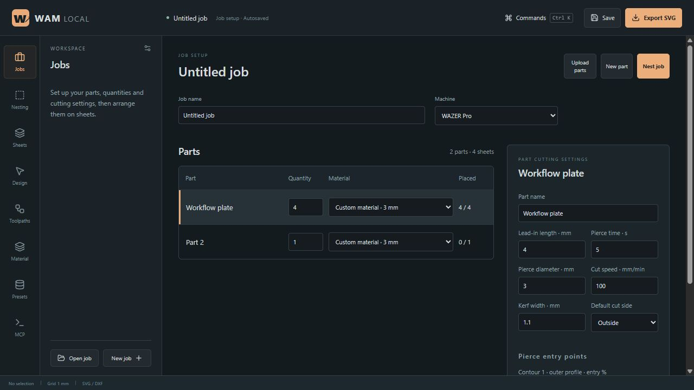

# Wam Local

An independent, offline waterjet design and CAM workbench for power users. Electron + React + TypeScript, with a shared geometry engine and a local MCP server. This is a working **0.2 alpha**, not yet a WAM replacement for running a machine.



## Jobs, parts and sheets

Navigation starts with **Jobs → Nesting → Sheets**, followed by the editing and process tools. Jobs opens a setup workspace without a bed preview: assign quantities and materials in the part list, then select a part to edit lead-in length, pierce time/diameter, feed, kerf, cut side and contour entry positions. Process edits create a part-specific profile while retaining the physical stock identity. Open the part editor to pick entry positions on geometry and place tabs. Uploaded parts stay in job setup.

The bed preview has no permanent metrics strip or parts table below it. **Parts & checks** opens the parts/preflight panel when needed. Sheets manages sheet assignments; opening a sheet takes you to its nesting workspace.

A job contains reusable part definitions and any number of sheets. Each part has its own material and requested quantity; placements on sheets reference that definition. Edit a definition once to update its copies. Upload SVG/DXF parts, or choose **New part** and draw with the rectangle, circle or polygon tools. Copying a placed part increases its requested quantity when needed.

Each sheet has a stock size, material and X/Y WCS origin on the machine bed. The preview shows the full bed, physical stock, usable sheet area and placed parts in that order. Fit stock zooms in for editing. **Nest job across sheets** places requested quantities on compatible materials and creates additional sheets as needed. Physical stock name, thickness and machine determine compatibility, allowing different cutting profiles for the same stock.

In a part editor, select a contour to override inside/outside/centerline compensation, place tabs with individual widths, or set its entry position. The Material panel edits job settings; **Presets** manages the reusable defaults database. Jobs embed their material settings, so editing database defaults does not silently change existing jobs. Apply a preset explicitly to use new values. The database supports JSON import/export and includes captured WAM Pro defaults; unsupported thicknesses and Desktop settings still require custom values.

Set a known pierce diameter to preview its footprint and receive warnings when it reaches a finished profile or stock boundary. A zero diameter means unknown and produces an unverified-clearance warning. These checks do not replace machine validation.

Saved `.wam.json` files now use job schema version 2. Opening a version 1 project migrates it in memory while preserving placed geometry; the source file is unchanged until saved. Keep original files when moving between application versions. Older versions cannot read version 2 jobs.

## Run

Requires Node.js 24 and npm for development. Dependencies are downloaded during installation; the built application works offline.

```powershell
npm ci
npm run desktop
```

`npm run dev` opens the development server at http://127.0.0.1:5173. `npm run package` builds a Windows installer and portable executable under `release/`, with publishing disabled. A packaged app needs no Node.js installation for its editor. Builds are currently unsigned.

## Update from GitHub

In the Windows app, choose **Help → Update from GitHub…**. It checks stable releases from `AudacityMicro/WamLocal` only when requested. You can decline the download, or download and defer installation. Choosing **Install and restart** closes the app and opens the installer; save project files first. Download checksums are verified by `electron-updater`. Failed checks never report the app as up to date.

The editor continues to work offline. The updater uses its own Electron session; renderer network requests remain blocked. No GitHub token is embedded. The repository and release assets must be publicly accessible. Development builds show a packaged-app message instead of contacting GitHub. For portable or unpacked copies, updating installs the new version and creates the installed app's desktop shortcut; it does not overwrite the portable folder in place.

The repository has no published releases as of 2026-11-10, so a live newer-version install cannot yet be validated. Release checks, cancellation, deferred installation and verification failures have automated coverage; a real two-version upgrade remains a release check.

`.github/workflows/windows-release.yml` builds and tests the Windows artifacts. A manual workflow run uploads build artifacts without publishing. A pushed `v<package.json version>` tag also publishes a release containing the installer, blockmap and `latest.yml`. Increase the package version before each subsequent release. No release is published by local packaging. Keep all update assets together in the same release.

## Working features

- Separate WAZER Desktop and Pro profile selections, each with a 460 × 305 mm maximum envelope. The Material panel includes 449 captured Pro thickness records across 24 materials with coarse/medium/fine Speed Mode feeds. Outlier tab defaults are visible but blocked; Desktop and uncaptured thicknesses require custom settings.
- Millimetre-based SVG canvas, zoom, pan, grid snapping, object movement and numeric position, rotation and scale.
- SVG import with physical sizing, transformed groups, curves flattened at a nominal 0.08 mm tolerance, primitive shapes and compound holes. Unsupported resources, text, definitions and active content are rejected rather than silently omitted. SVG documents without physical units use 96 px/in.
- DXF LINE, 2D LWPOLYLINE/POLYLINE (including bulged arc segments), CIRCLE and ARC import. Reads millimetre/inch `$INSUNITS`; otherwise uses the selected import unit. Bulged segments convert automatically to line segments with a maximum chord deviation of 0.08 mm, including clockwise/major arcs and the last closing segment. Flat +Z/-Z polyline extrusion is supported. Unsupported entities reject the import. No spline, ellipse, block, tilted-plane or 3D mesh support yet.
- Rectangle, circle and polygon/polyline creation, node dragging, duplicate, delete, keyboard nudging and undo/redo.
- Copy/paste selected parts with Ctrl+C/Ctrl+V, clipboard buttons, or the Windows Edit menu. Copies preserve geometry, holes and transforms, work between Wam Local jobs/windows, get new IDs, and offset each repeated paste by 8 mm. Normal text editing keeps its own clipboard behavior. External CAD/SVG clipboard formats are not imported by paste; use vector import for those.
- Double-click a part on the bed to reveal four mouse rotation handles and on-part Duplicate/Delete buttons. Rotation keeps the part center fixed; Shift snaps to 15° increments. Click another part, click the background, or press Escape to dismiss the controls. A rotation drag undoes as one action.
- Shape-aware nesting uses the MIT-licensed SVGnest placement worker, with no-fit polygons, optional 90° rotations, margins and spacing. MaxRects supplies a fast initial candidate. Optimization runs in a cancellable background worker; results are independently checked against buffered outlines and sheet bounds. This bounded heuristic can miss a valid fit and does not prove an optimum. Nesting inside holes is disabled; disconnected islands use a conservative convex hull. Kerf/lead allowances are reserved, while pierce footprints receive separate preflight checks.
- Clipper-based inside/outside kerf compensation, centerline paths, hole-first ordering, evenly spaced outer-contour tabs, straight tangent lead previews, path scrubbing and animated simulation.
- Warnings for degenerate/open contours, disappearing kerf offsets, actual shape overlap, toolpaths outside stock, unplaced quantities, WCS envelope limits and pierce interference. These remain preliminary machining checks.
- Approximate cut + pierce time using the entered feed and pierce time. Does not include acceleration, rapid travel, dwell variations, abrasive consumption or setup overhead.
- Browser/Electron-local autosaved draft; portable versioned `.wam.json` files; SVG layout export in physical millimetres.
- Twenty-one MCP tools sharing the editor's schemas, job workflow, nesting, material database and preview code. Ten legacy project tools remain available for version 1 files.

**Machine-ready `.gcode` output is intentionally not implemented yet.** No machine control, USB connection, or pump/abrasive commands are emitted. Simulation is a geometry preview; leads, containment and cutting order need further validation. See [ROADMAP.md](ROADMAP.md) for the work needed to reach functional parity.

## Editing shortcuts

| Action | Shortcut |
| --- | --- |
| Commands | Ctrl+K |
| Save project | Ctrl+S |
| Undo / redo | Ctrl+Z / Ctrl+Shift+Z |
| Duplicate | Ctrl+D |
| Copy / paste selected part | Ctrl+C / Ctrl+V |
| Show rotation handles and part actions | Double-click a part on the bed |
| Snap mouse rotation | Hold Shift while dragging a rotation handle |
| Delete selected part | Delete |
| Select / nodes / polygon pen | V / N / P |
| Nudge selected part | Arrow keys; Shift for 10 mm |
| Finish closed polygon / open polyline | Enter / Shift+Enter |
| Cancel drawing | Escape |
| Pan / zoom | Alt+drag or middle-drag / wheel |

Imported vectors are initially one part, preserving the relative placement of contours and holes. Node editing changes the flattened geometry, not original Bézier control handles. Project files keep geometry in local coordinates and store object transforms separately. Editor save/open uses normal file download and file selection; it does not watch or overwrite an opened file automatically.

## MCP setup

The server uses **stdio**, not HTTP. It has no network listener. Configure a client to launch it with a dedicated project folder:

```json
{
  "mcpServers": {
    "wam-local": {
      "command": "node",
      "args": ["C:/path/to/WamLocal/node_modules/tsx/dist/cli.mjs", "C:/path/to/WamLocal/src/mcp/server.ts"],
      "env": {"WAM_PROJECT_DIR": "C:/path/to/waterjet-projects"}
    }
  }
}
```

After building, Node can launch `dist-mcp/server.mjs` directly with installed production dependencies. The Electron executable can also host the server through its embedded Node runtime, without Node installed. Point MCP clients at the **unpacked application executable**, not the portable self-extraction wrapper:

```json
{
  "mcpServers": {
    "wam-local": {
      "command": "C:/path/to/WamLocal/release/win-unpacked/Wam Local.exe",
      "args": ["C:/path/to/WamLocal/release/win-unpacked/resources/app.asar/dist-mcp/server.mjs"],
      "env": {"ELECTRON_RUN_AS_NODE": "1", "WAM_PROJECT_DIR": "C:/path/to/waterjet-projects"}
    }
  }
}
```

Copy the entire `win-unpacked` directory when installing this form of the app. Keep MCP project files in a normal writable directory outside the app package. Without `WAM_PROJECT_DIR`, the server uses `projects/` relative to its working directory. Accepted filenames are simple names such as `bracket.wam.json`, with no directory separators. Mutations are serialized and saved through a temporary file and rename.

| Tool | Purpose |
| --- | --- |
| `create_project` | Create a project; fails if the filename already exists |
| `read_project` | Read a saved project |
| `write_project` | Save a complete validated project, including custom contours/settings; overwrites the named file |
| `add_shape` | Add a rectangle or circle |
| `update_part` | Replace a part by its ID |
| `nest_project` | Nest all parts on one stock sheet |
| `inspect_toolpaths` | Return moves, warnings and estimated time |
| `export_svg` | Return a dimensioned SVG layout |
| `list_material_presets` | List exact captured Pro records, quality feeds, source and outlier reasons; filter by machine and optional exact material name |
| `apply_material_preset` | Apply a record by preset ID and quality; reject machine mismatch and outliers |
| `create_job`, `read_job`, `write_job` | Create, load/migrate and save version 2 jobs |
| `add_job_part`, `update_job_part` | Manage reusable geometry, quantities and part materials |
| `add_sheet`, `update_sheet` | Manage sheet stock, material and WCS origin |
| `nest_job` | Place requested quantities across compatible sheets |
| `inspect_job` | Return job issues and per-sheet previews, including bed-coordinate moves |
| `read_material_library`, `write_material_library` | Read/save the reusable defaults database |

The ten project tools above the job tools operate on the legacy version 1 schema. Use the job tools for new files. The desktop database lives in Electron's user-data directory as `material-library.json`; MCP defaults to `%APPDATA%/wam-local/material-library.json`. Set `WAM_MATERIAL_LIBRARY` to the desired shared database path when using a different profile. Database writes are serialized within each process; avoid concurrent writers.

The server and editor share **files**, not an in-memory session. Save from the editor before using MCP on that project; reopen it to load MCP changes. Avoid editing the same file independently in multiple clients. A single server serializes its own writes; separate server processes do not share a lock. Live synchronization is planned.

## Checks

Live WAM 2.5.0 **Pro** reference jobs have now been captured and compared. See [reference results](fixtures/wam-reference/RESULTS.md) for the five cases, measured differences, source exports, and the untested Desktop scope. These references do not enable machine-ready export.

Material checks cover 449 thickness points across all 24 Pro materials, including 246 independent validation points and 4,939 recorded parameter values. The editor and MCP share the captured Speed Mode presets. Applying a preset sets material name, thickness, quality feed, pierce time, abrasive rate and tab/lead defaults, and preserves kerf and tab count. Thirty-four tab outliers exceed the editor's 20 mm limit and are blocked, leaving 415 applicable thickness records. Abrasive rate is saved for reference, not included in simulation estimates. Preset selection survives project save/open; editing captured parameters changes the status to custom. Interpolation failed independent checks, so arbitrary-thickness parity, executable Eco behavior and Desktop material values remain unverified. See the [material report](fixtures/wam-reference/materials/README.md).

Regenerate the bundled preset data from the original reference records with `node scripts/build-material-presets.mjs` after adding validated captures. The regression suite compares every bundled quality feed and parameter against those source captures.

```powershell
npm test
npm run build
npm run verify:mcp
# Start npm run dev in another terminal for the UI check:
npx playwright install chromium
npm run verify:ui
```

`scripts/verify-electron.mjs` exercises the built Electron app and bundled MCP server. `npm audit` checks dependency advisories. The minimatch override selects the patched package used by build tooling; retain packaging checks when updating it.

## Architecture

- `src/core/model.ts`: geometry types, primitives and legacy project schema; `job.ts` and `job-ops.ts` define version 2 jobs and operations.
- `src/core/nesting.ts`: SVGnest/MaxRects adapter, no-fit polygons and placement validation. `src/vendor/svgnest/` contains the adapted MIT placement worker.
- `src/core/geometry.ts`: transformations, compensation, nesting, preview planning and SVG export. No React or Electron dependency.
- `src/core/import.ts`: strict browser SVG and DXF import adapters.
- `src/ui/`: React workbench and local draft persistence.
- `src/mcp/server.ts`: file-based stdio server, using the shared core.
- `electron/main.cjs`: isolated/sandboxed renderer, network request blocking, and native application menu. `electron/preload.cjs` exposes part copy/paste commands and fixed-path material database load/save through a sender-checked bridge; it does not expose Node or arbitrary filesystem access. `electron/updates.cjs` implements the manual GitHub update flow. The bundled MCP server runs separately in Electron's embedded Node mode.
- `dist-mcp/`: generated Node-compatible server bundle, packaged beside the editor.

The packaged renderer uses a content security policy and loads local assets. Editing requires no account or hosted API. No analytics, remote fonts, or WAZER code/assets are used. The optional manual updater contacts GitHub from the main process. WAZER/WAM names identify the target equipment and reference workflow; this project is independent of WAZER.

## Functional references

The implementation was built independently from public workflow descriptions and browser-exported reference jobs. No WAM code is included. A public browser asset was inspected during material investigation to locate the calculation boundary; its code was not copied.

- [WAZER project workflow](https://support.wazer.com/resources/preprocessing-temp/general-project-workflow)
- [File compatibility](https://support.wazer.com/resources/maintenance/wam-procedures/file-import-check-list)
- [Tabs and leads](https://support.wazer.com/wam-procedures-/background-and-operation-on-tabs-and-leads)
- [Machine specifications](https://wazer.com/waterjets/tech-specs/)

See [THIRD_PARTY.md](THIRD_PARTY.md) for component attribution and nesting-engine considerations.
